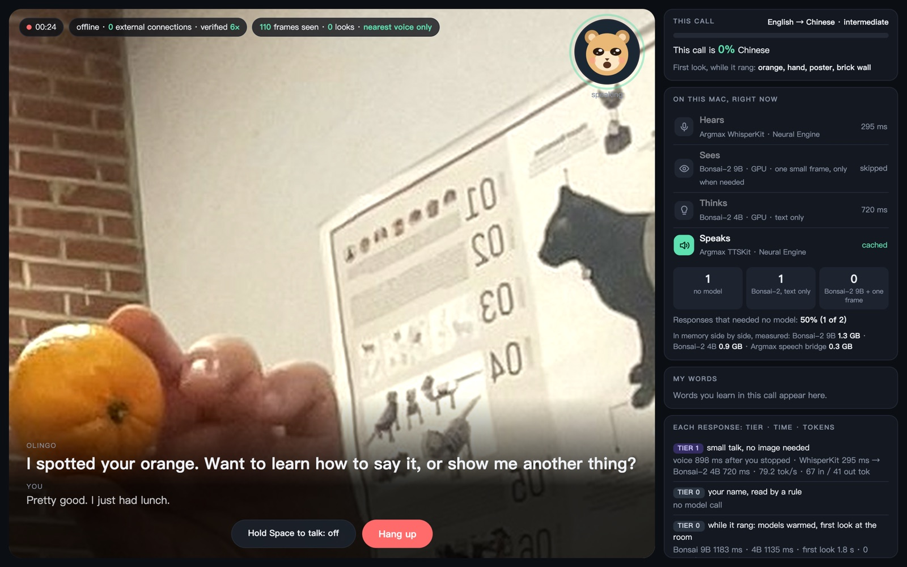
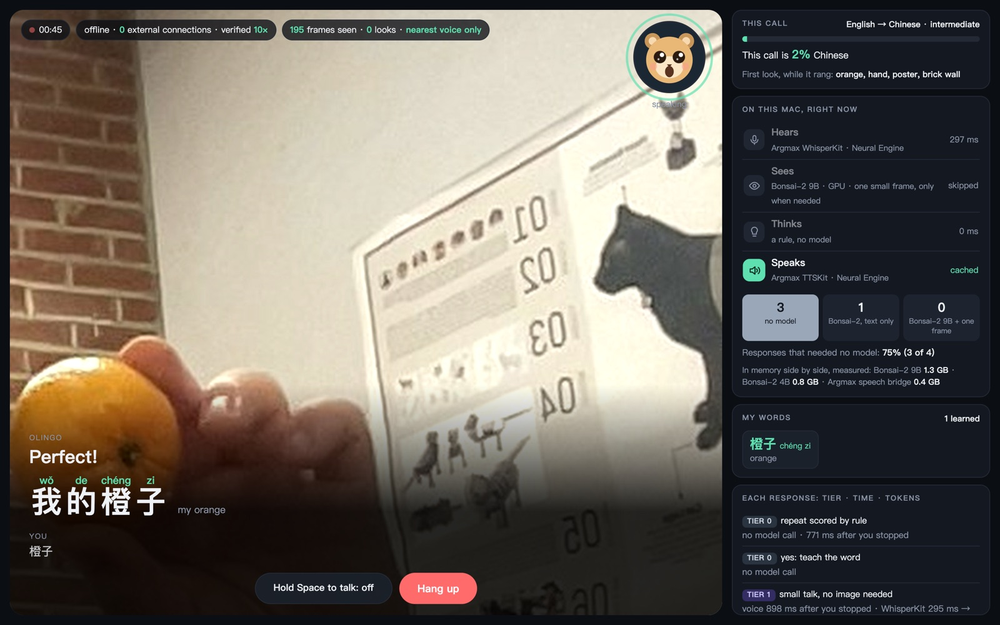
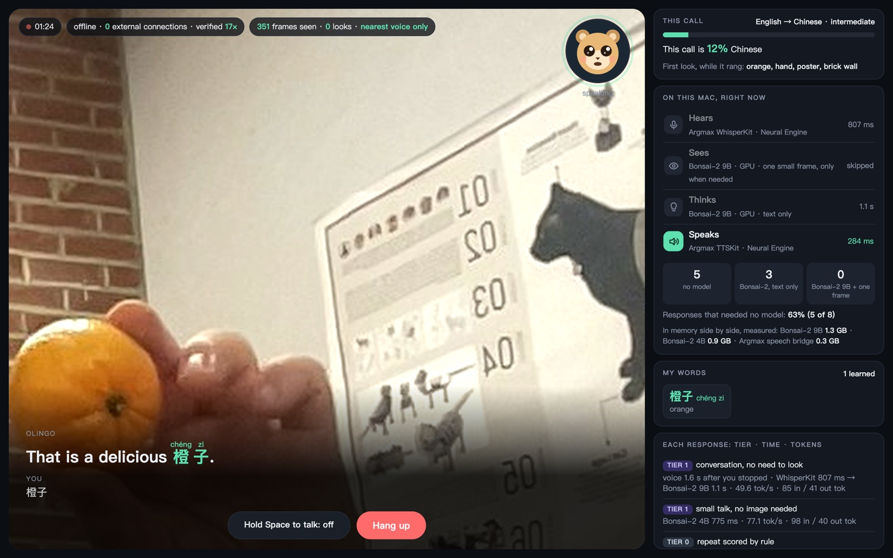
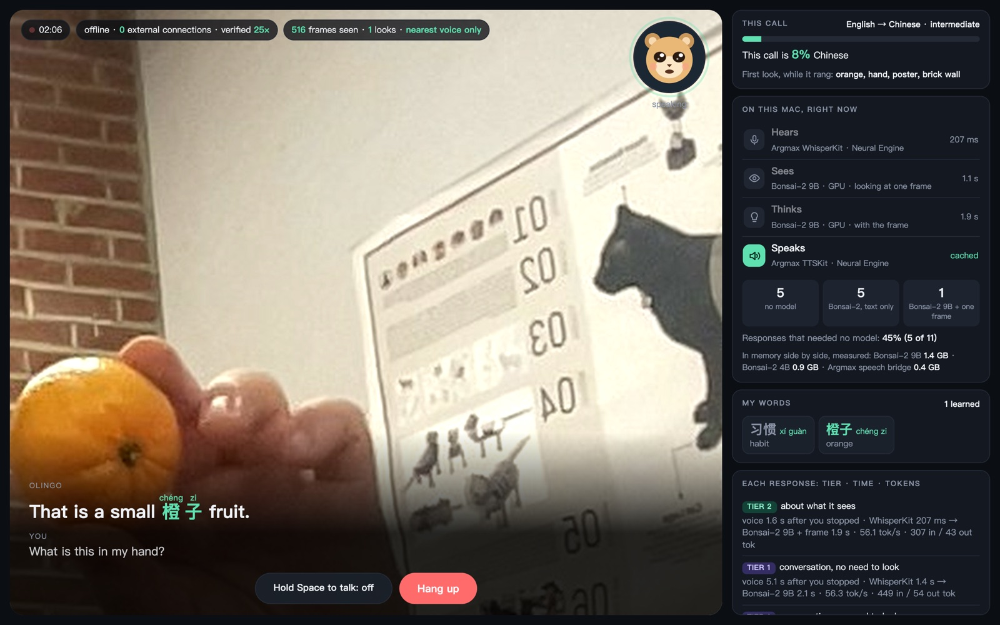
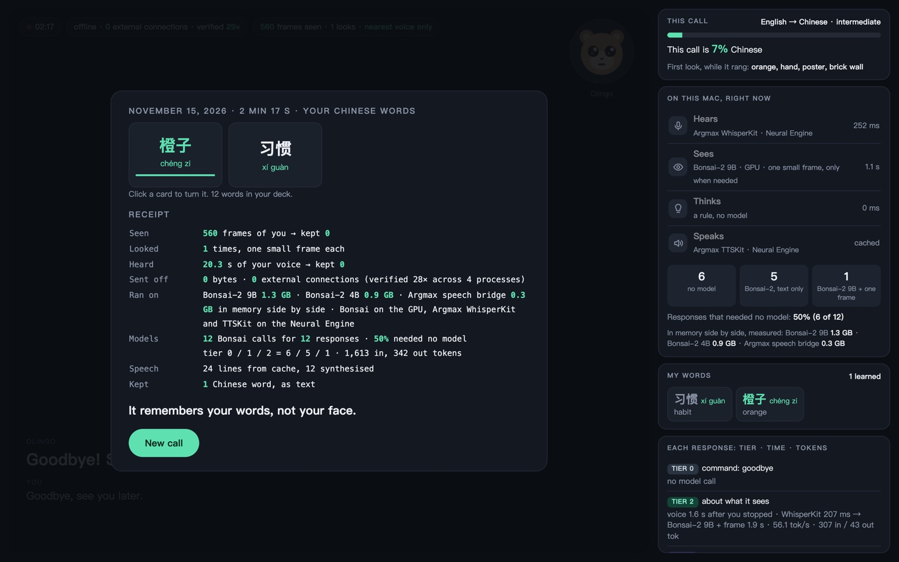
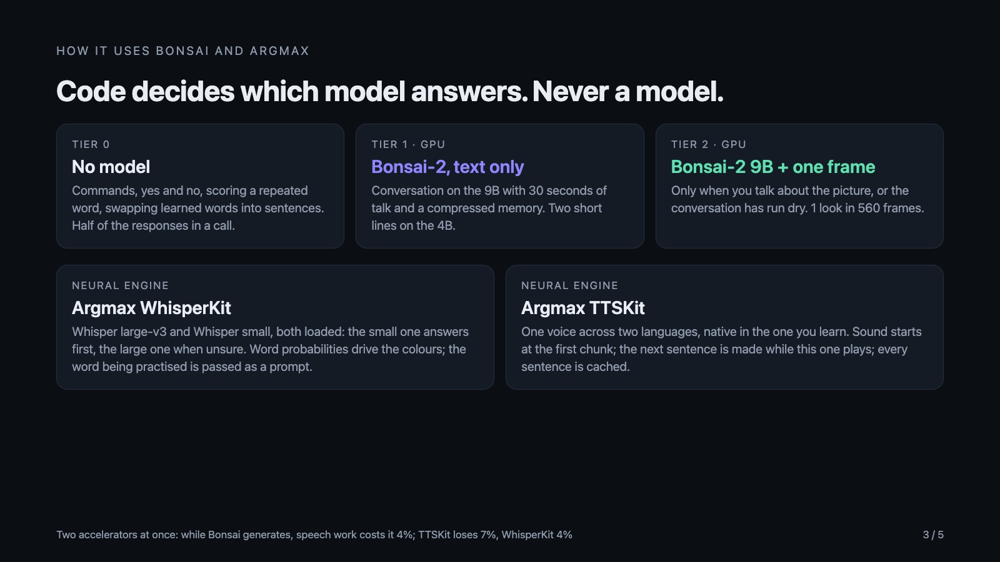

<h1 align="center">Olingo Live</h1>

<p align="center"><b>A language video call that can see you, running entirely on one Mac with WiFi off.</b><br>
Duolingo's Video Call with Lily, recreated on-device with PrismML Bonsai-2 and Argmax.</p>

<p align="center"><i>Lily can't see you. Olingo can, and no one else ever will. It remembers your words, not your face.</i></p>

<p align="center"></p>

<p align="center">Cornell Local AI Hackathon · theme: <b>Recreate</b> · built by <b>Bobby</b> and <b>Lixing</b></p>

---

## Why recreate it

<p align="center"></p>

| | Duolingo Video Call | **Olingo Live** |
|---|---|---|
| Sees what you hold up | no | **yes**: one small frame, only when you ask |
| Where it runs | a model in a data centre | **this Mac**: Bonsai-2 on the GPU, Argmax on the Neural Engine |
| Internet | required | **none**: runs with WiFi switched off |
| Your voice | goes to their servers | **stays in memory**, like the camera frames: 0 connections out, checked every 5 seconds |
| What you learn | a conversation the app steers | **whatever you show it or ask about** |
| Cost | part of a paid subscription | **open**: the code is here, the models are Bonsai-2 and Argmax |
| After the call | | **only the words you learned** are kept, as text |

## What a call is like

<table>
<tr>
<td width="33%"><br><sub><b>1.</b> It asks your name, then offers something it already saw while the call was ringing.</sub></td>
<td width="33%"><br><sub><b>2.</b> You repeat the word. Each character is coloured by how clearly it was heard. Miss it, and the tutor says it again, slowly.</sub></td>
<td width="33%"><br><sub><b>3.</b> Then two phrases with the word: explained first, then you say them, then they are checked.</sub></td>
</tr>
<tr>
<td><br><sub><b>4.</b> You just talk. It follows what you say, remembers it, and never asks the same thing twice.</sub></td>
<td><br><sub><b>5.</b> "What is this?" Only now does Bonsai get a frame. The first sentence is spoken while the rest is still being written.</sub></td>
<td><br><sub><b>6.</b> Hang up: flashcards of your words, and a receipt of what was seen, heard, kept (words) and sent (nothing).</sub></td>
</tr>
</table>

Every number on the page is measured during the call. These screenshots are from one real call on this Mac.

You speak English, Chinese, French or Japanese; you learn Chinese (with pinyin), English, Spanish, French, Japanese,
Korean, German, Italian or Portuguese. One voice speaks for the whole call, native in the language you are learning.

## How it uses Bonsai and Argmax

<p align="center"></p>

| In the call | Model | What it does | Measured on a MacBook Pro M4 Pro, 24 GB |
|---|---|---|---|
| "What is this?" | **Bonsai-2 9B** + vision projector | Looks at one 512x288 frame. A grammar forces a structured reply (sentence, word, teaching sentence, question), streamed, so speech starts on the first sentence. | 56 tok/s · voice 1.6 s after you stop talking |
| Conversation | **Bonsai-2 9B**, text only | Answers with the last 30 seconds of talk and a compressed memory of everything older. | first sentence 0.5 to 1.1 s |
| Two short lines | **Bonsai-2 4B** | The reply to the warm-up question and the remark after a new word. | 77 to 85 tok/s |
| First look, phrases, "was this asked before?" | **Bonsai-2 9B**, second slot | Helper calls beside the conversation, without touching its cached prompt. | look 1.3 to 1.5 s · phrases 0.9 s · yes/no 0.27 s |
| Both models stay loaded | ternary weights | Small enough to sit in memory side by side, next to the speech models. The page shows it live. | 9B 1.3 to 1.5 GB · 4B 0.9 GB |
| Hears you | **Argmax WhisperKit** | Whisper large-v3 and Whisper small, both loaded: the small one answers first, the large one when unsure. Word probabilities colour what you repeat; the word being practised is passed as a prompt. | small 0.15 to 0.3 s · large 0.7 to 0.9 s |
| Speaks | **Argmax TTSKit** | One voice across two languages. Sound starts at the first chunk; the next sentence is made while this one plays; every sentence is cached. | first sound 0.35 s · cached 0.15 s · 2.4x real time |
| All at once | GPU + Neural Engine | Bonsai generating while speech is synthesised and transcribed. | Bonsai -4% · TTSKit -7% · WhisperKit +4% time |

**Code decides which model answers, never a model.** Tier 0 is no model at all (commands, yes and no, scoring a
repeated word, swapping learned words into sentences): 6 of the 12 responses in the call above. Tier 1 is Bonsai on text.
Tier 2 is Bonsai with one frame, and only when your words point at the picture or the conversation has run dry.
In the call in the screenshots Bonsai looked at 1 of 560 frames, and 24 of 36 spoken lines came from the cache.

**Memory without a bigger context.** The last 30 seconds are kept word for word. Older turns are compressed to a
256-number sketch and a few words. Every question it asked stays for the whole call; a new one is compared with
them by the sketch and then by a yes/no from Bonsai, so nothing is asked twice.

## Private, and you can check it

- Frames and audio exist only in memory. Nothing writes a frame or a recording to disk.
- Every process listens on 127.0.0.1 only. While a call runs, the app lists the sockets of its own processes every
  five seconds and shows the count of any that are not local: `0 external connections, verified 28x`.
- `scripts/offline_check.sh` turns WiFi off, starts everything cold, runs every part of a call and turns WiFi back
  on. Latest run: **13 of 13** (`docs/offline_check.log`).

## Olingo in your hand: the Raspberry Pi

The same call can run through a small device, so it is not tied to the laptop: a Raspberry Pi 5 with a camera and a
ReSpeaker microphone and speaker. It runs **Luma**, our Bluetooth relay; the Mac stays the brain. Press
**Connect Luma** on the start screen: the page shows what the Pi sees, Olingo hears through the Pi and speaks
through it, and the Pi says "Luma is connected."

| Over Bluetooth, measured | |
|---|---|
| Connects in | about 4 s |
| Picture | 640x360, 5 a second |
| Microphone | complete: 3.0 s of sound every 3 s, longest gap 0.17 s |
| Sound | compressed 4 to 1 in both directions (65 kbit/s) |
| WiFi | the Pi needs none; the Mac's stays off |

What made it work: a Mac puts a Bluetooth serial link into power-saving mode, one packet every 40 ms, about
130 kbit/s. With that mode refused on the Pi the same link carried 830 kbit/s (`agent/pi_bt_fast.sh`).

## Run it

Apple Silicon Mac, macOS 15 or later, Chrome.

```sh
cd olingo/bridge && swift build -c release     # once
cd .. && scripts/run.sh                        # Bonsai 9B + 4B, the backend, the speech bridge
open http://localhost:8765                     # allow the camera
scripts/stop.sh
```

```
~/Hackthon/
  olingo/              this repository
  bin/llama/           PrismML llama.cpp build (llama-server)
  models/bonsai2-9B/   Ternary-Bonsai-2-9B-PQ2_0.gguf + mmproj      models/bonsai2-4B/   the 4B
  argmax-oss-swift/    Argmax SDK (the bridge builds against it)
  .venv/               Python 3.13, requirements.txt
~/Documents/huggingface/models/   Argmax models: Whisper large-v3 and small, Qwen3-TTS 0.6B
```

`scripts/setup_new_mac.sh` puts all of this in place on another Mac from our backup. In a loud room, tick
"hold Space to talk". `python -m unittest discover -s tests` runs 58 tests; none needs a model.

## What is where

| Path | |
|---|---|
| `backend/call.py` | The call: opening, routing, teaching, scoring, memory, when to look. |
| `backend/brain.py` | Every Bonsai call. Output forced by a grammar, streamed sentence by sentence. |
| `backend/memory.py` | 30 seconds word for word, the rest compressed, questions never repeated. |
| `backend/speech.py`, `bridge/` | The Swift process that runs Argmax WhisperKit and TTSKit, and its Python client. |
| `backend/agent.py`, `bridge/bt/` | The link to the Raspberry Pi over Bluetooth. |
| `backend/privacy.py` | The socket audit and the memory check. |
| `web/index.html` | The page. Plain HTML, CSS and JavaScript; no framework, nothing loaded from the internet. |
| `docs/slides.html` | The four-minute presentation; opens offline. |

## Hackathon rules

Language models: only Bonsai-2 (9B and 4B). Speech: Argmax WhisperKit and TTSKit. Runs on a Mac with WiFi off.
